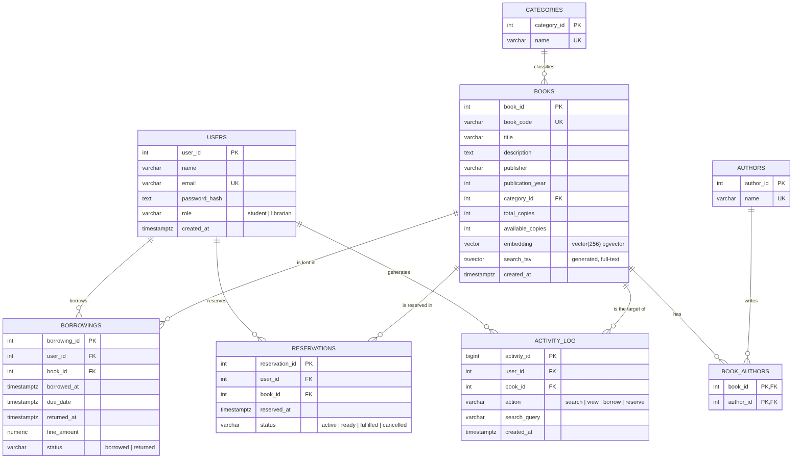
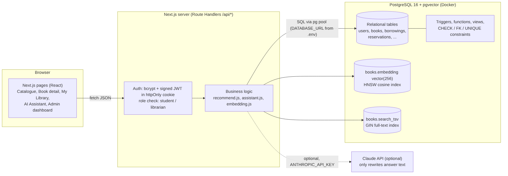

# Smart Library Management and Book Recommendation System
**DBMS Experiential Learning – Level 3 Project documentation**

Team members: _<Name 1, Roll no.>_ · _<Name 2, Roll no.>_  (fill in; see §17 for the contribution table)

---

## 1. Problem statement
College libraries still depend on manual registers or basic catalogue software. Students cannot easily see which books are
available, cannot reserve a book that is out on loan, and – most importantly – get no help *discovering* books that match their
interests. Librarians have no quick view of overdue loans, popular titles or unused books.

## 2. Objectives
1. Digitise the library workflow: search, borrow, reserve and return books with automatic due dates and fines.
2. Keep stock and loan data **always consistent** by enforcing the rules inside the database (constraints, triggers, transactions).
3. Recommend books per student from their searches, views and borrowing history.
4. Let students ask for books in natural language through an AI assistant.
5. Give the librarian an admin dashboard for books, users, availability and borrowing records.

## 3. Scope
**In scope:** two roles (student, librarian); catalogue; borrowing, reservation, return, fines; recommendations; AI assistant;
admin dashboard; sample data.
**Out of scope (future work):** e-books, payment gateway for fines, e-mail/SMS reminders, barcode scanning, multi-branch libraries.

## 4. Functional requirements
| ID | Requirement | Role |
|---|---|---|
| F1 | Register, log in, log out (passwords hashed) | all |
| F2 | Search books by keyword (full-text) or by meaning (semantic/vector); filter by category and availability; sort | all |
| F3 | View book details, availability, reservation queue length and "more like this" | all |
| F4 | Borrow a book (max 3 at once, 14-day loan, blocked when overdue books exist) | student |
| F5 | Reserve a book that has no free copy; cancel reservation; reservation becomes *ready* when a copy is returned | student |
| F6 | Return a book; fine of Rs. 2 per started late day is calculated automatically | student / librarian |
| F7 | "My Library": current loans, history, reservations, fines | student |
| F8 | Personalised recommendations ("For you", "Readers like you also borrowed"); popular books for new users | student |
| F9 | AI assistant: natural-language recommendations, e.g. "something like Dune", "available books on space" | all |
| F10 | Add / edit / delete books and set copies; delete is refused when loan history exists | librarian |
| F11 | Manage users (promote/demote, delete); issue books to students; view all borrowing records | librarian |
| F12 | Dashboard: totals, overdue loans, popular books, category statistics, top readers, trending searches, never-borrowed books | librarian |

## 5. ER diagram


Relationships: *Category 1—N Book*; *Book M—N Author* (via `book_authors`); *User 1—N Borrowing*, *Book 1—N Borrowing*;
*User 1—N Reservation*, *Book 1—N Reservation*; *User 1—N ActivityLog*, *Book 1—N ActivityLog*.
(`BORROWINGS` is the resolution of the M—N "user borrows book" relationship; it carries its own attributes: dates, fine, status.)

## 6. Relational schema
(PK = primary key, FK = foreign key, UK = unique)

```
users(user_id PK, name, email UK, password_hash, role, created_at)
categories(category_id PK, name UK)
authors(author_id PK, name UK)
books(book_id PK, book_code UK, title, description, publisher, publication_year,
      category_id FK→categories, total_copies, available_copies, embedding vector(256),
      search_tsv tsvector [generated], created_at)
book_authors(book_id PK,FK→books, author_id PK,FK→authors)
borrowings(borrowing_id PK, user_id FK→users, book_id FK→books, borrowed_at, due_date,
           returned_at, fine_amount, status)
reservations(reservation_id PK, user_id FK→users, book_id FK→books, reserved_at, status)
activity_log(activity_id PK, user_id FK→users, book_id FK→books [nullable], action, search_query, created_at)
```
The schema is in **3rd normal form**: authors and categories are separate tables (no repeating groups, no transitive dependency),
the M—N book/author link is its own table, and every non-key attribute depends only on its table's key.
The only deliberate denormalisation is `books.available_copies`, kept correct by triggers (§9.4) so the catalogue is fast.

## 7. Database choice and justification
| Data | Stored in | Why |
|---|---|---|
| Users, books, loans, reservations, fines, categories, authors | **PostgreSQL (relational)** | Highly structured, many relationships, needs ACID transactions, foreign keys and constraints so that two students can never borrow the last copy at the same time. |
| Book meaning (embeddings) and user-interest matching | **pgvector inside the same PostgreSQL** | Recommendations and the AI assistant need *nearest-neighbour* search over text meaning – not possible with `LIKE` or B-tree indexes. Using pgvector keeps vectors **next to the books they describe**: one transaction updates the book and its embedding, one SQL query can combine vector similarity with availability/category filters and joins, and there is no second server to run or keep in sync. |
| Search / view history | PostgreSQL (`activity_log`) | Append-only events, queried with joins and aggregates for both the recommender and the dashboard. |

A separate NoSQL store (e.g. MongoDB) was deliberately **not** added: nothing in this problem is schema-less or document-shaped,
and adding it would only duplicate data. (Project requirement 3, Option 2: *SQL + Vector database*.)

## 8. Data dictionary
### users
| Column | Type | Constraints | Meaning |
|---|---|---|---|
| user_id | SERIAL | PK | Identifier |
| name | VARCHAR(100) | NOT NULL, CHECK length(trim) ≥ 2 | Full name |
| email | VARCHAR(150) | NOT NULL, UNIQUE, CHECK regex | Login id |
| password_hash | TEXT | NOT NULL | bcrypt hash (never plain text) |
| role | VARCHAR(20) | NOT NULL, DEFAULT 'student', CHECK IN (student, librarian) | Access level |
| created_at | TIMESTAMPTZ | NOT NULL, DEFAULT now() | Registration time |

### categories / authors
`category_id`/`author_id` SERIAL PK; `name` VARCHAR NOT NULL UNIQUE.

### books
| Column | Type | Constraints | Meaning |
|---|---|---|---|
| book_id | SERIAL | PK | Identifier |
| book_code | VARCHAR(30) | NOT NULL, UNIQUE, CHECK length ≥ 3 | ISBN / accession code |
| title | VARCHAR(255) | NOT NULL, CHECK not blank | Title |
| description | TEXT | NOT NULL, DEFAULT '' | Summary (used for search and embedding) |
| publisher, publication_year | VARCHAR(120), INT | year CHECK 1400–2100 | |
| category_id | INT | NOT NULL, FK → categories, ON DELETE RESTRICT | Topic |
| total_copies | INT | NOT NULL, CHECK ≥ 0 | Copies owned |
| available_copies | INT | NOT NULL, CHECK 0 ≤ x ≤ total_copies | Copies on the shelf (maintained by triggers) |
| embedding | vector(256) | HNSW index (cosine) | Semantic vector of the book |
| search_tsv | tsvector | GENERATED ALWAYS … STORED, GIN index | Full-text document of title + description |

### borrowings
| Column | Type | Constraints | Meaning |
|---|---|---|---|
| borrowing_id | SERIAL | PK | |
| user_id / book_id | INT | NOT NULL, FK (CASCADE / RESTRICT) | Who borrowed what |
| borrowed_at, due_date | TIMESTAMPTZ | NOT NULL, CHECK due_date > borrowed_at; default due = now()+14 days | |
| returned_at | TIMESTAMPTZ | NULL while on loan, CHECK ≥ borrowed_at | |
| fine_amount | NUMERIC(8,2) | NOT NULL, CHECK ≥ 0 | Set by trigger on return |
| status | VARCHAR(10) | CHECK IN (borrowed, returned) and CHECK (status='returned') = (returned_at IS NOT NULL) | |
| — | | **UNIQUE** partial index (user_id, book_id) WHERE returned_at IS NULL | A user cannot hold the same book twice |

### reservations
`reservation_id` PK; `user_id`, `book_id` FK (CASCADE); `reserved_at`; `status` CHECK IN (active, ready, fulfilled, cancelled);
partial UNIQUE (user_id, book_id) WHERE status IN (active, ready).

### activity_log
`activity_id` BIGSERIAL PK; `user_id` FK; `book_id` FK nullable; `action` CHECK IN (search, view, borrow, reserve);
`search_query`; `created_at`. CHECK: a *search* row must have a query, every other row must have a book.

## 9. Database implementation (`db/schema.sql`)
### 9.1 DDL
`CREATE TABLE` ×8 with primary keys, foreign keys and constraints; `ALTER TABLE … ADD CONSTRAINT` ×4 (due-date, return-date,
status/returned_at consistency, book-code length); `DROP … IF EXISTS … CASCADE` at the top makes the script re-runnable; `CREATE INDEX` ×12.

### 9.2 Indexes
| Index | Purpose |
|---|---|
| `idx_books_tsv` GIN(search_tsv) | full-text search |
| `idx_books_embedding` HNSW(embedding vector_cosine_ops) | approximate nearest-neighbour vector search |
| `uq_active_borrow`, `uq_active_reservation` (partial UNIQUE) | business rules enforced as indexes |
| `idx_borrowings_open_due` (partial, WHERE returned_at IS NULL) | fast overdue queries |
| `idx_activity_user_time` (user_id, created_at DESC) | latest history of a user for recommendations |
| FK indexes on `borrowings`, `book_authors`, `reservations`, `books.category_id` | join speed |

### 9.3 Views
`v_book_catalog` (book + category + aggregated authors + loan count), `v_overdue_loans`, `v_popular_books`, `v_category_stats`.

### 9.4 Stored functions and triggers
| Object | What it does |
|---|---|
| `fn_calc_fine(due, returned)` | Rs. 2 × started days late |
| `fn_borrow_book(user, book)` | inserts the loan and the activity-log row |
| `fn_return_book(borrowing)` | marks returned, returns the fine, errors if already returned |
| `trg_borrowing_before_insert` | locks the book row (`FOR UPDATE`), checks stock, 3-book limit, overdue block, then decrements `available_copies` |
| `trg_borrowing_after_insert` | marks the user's own waiting reservation *fulfilled* |
| `trg_borrowing_before_update` | on return: computes `fine_amount`, sets `status`; forbids re-opening |
| `trg_borrowing_after_update` | gives the copy back and sets the first waiting reservation to *ready* |
| `trg_reservation_before_insert` | only unavailable books can be reserved; not for a book you hold |

### 9.5 Advanced database concepts demonstrated (requirement: ≥ 4)
| # | Concept | Where |
|---|---|---|
| 1 | **Transactions** | `withTransaction()` in `lib/db.js`; borrow, return, reserve and book save run as BEGIN…COMMIT with automatic ROLLBACK (test T1) |
| 2 | **Views** | 4 views, used by catalogue, dashboard and recommender |
| 3 | **Stored functions** | `fn_borrow_book`, `fn_return_book`, `fn_calc_fine` |
| 4 | **Triggers** | 5 triggers (stock, limits, fines, reservation queue) |
| 5 | **Indexing** | B-tree, partial, unique, GIN, HNSW |
| 6 | **Full-text search** | generated `tsvector` + `websearch_to_tsquery` + `ts_rank` |
| 7 | **Vector similarity search** | pgvector `<=>` cosine distance (§10) |

## 10. Vector database / semantic search
| Question | Answer |
|---|---|
| What is converted to embeddings? | Every book (title ×2 + category ×2 + authors + description), every search phrase, assistant question, and the user's interest profile. |
| Which model? | A **lightweight offline embedding model written for this project** (`lib/embedding.js`): tokenise → remove stop-words → light stemming → *feature hashing* of words and word pairs into 256 slots (FNV-1a, signed) + a **topic-concept lexicon** (e.g. "neural", "learning" → `ai_ml`) so books on the same topic land close together even with different words → log term weighting → L2 normalisation. No download, no API key, deterministic, and it makes the project run anywhere. It can be swapped for a transformer model (e.g. all-MiniLM) by changing `embedDocument/embedQuery` and the column size. |
| How are vectors stored? | `books.embedding vector(256)` (pgvector) in the same row as the book. Re-computed whenever a librarian adds or edits a book. |
| Similarity metric? | **Cosine distance** (`<=>`), score = 1 − distance. HNSW index with `vector_cosine_ops`. |
| How are results retrieved? | `ORDER BY embedding <=> $query LIMIT k`, joined with `v_book_catalog` so availability filters and book details come back in the same query. |

**Recommendation algorithm (`lib/recommend.js`).**
1. *Interest vector:* the user's last 80 events from `activity_log`. Weights: borrow 5, reserve 3, search 2, view 1.5, each multiplied by 0.97<sup>age rank</sup> (recent behaviour counts more). The weighted mean of the book/search vectors, normalised, is the profile.
2. *Content-based:* nearest books to the profile, excluding books the user already borrowed → "For you".
3. *Collaborative:* a 3-way self-join of `borrowings` finds books borrowed by other readers who share a book with the user → "Readers like you also borrowed".
4. *Cold start:* no history → most-borrowed books.

**AI assistant (`lib/assistant.js`).** Question → embedding; a book title mentioned in the question ("like Dune") is added as an anchor vector; a
small share of the user's profile is mixed in; "available" restricts to books in stock; top-5 by cosine similarity above a relevance threshold.
If `ANTHROPIC_API_KEY` is set, Claude rewrites only the wording and is given only the books returned by the database.

## 11. Important queries
```sql
-- Full-text search (books API)
SELECT c.title, ts_rank(c.search_tsv, websearch_to_tsquery('english', $1)) AS relevance
FROM v_book_catalog c
WHERE c.search_tsv @@ websearch_to_tsquery('english', $1) OR c.title ILIKE $2 OR c.authors ILIKE $2
ORDER BY relevance DESC, c.title LIMIT 12;

-- Semantic search (vector, cosine)
SELECT c.title, 1 - (b.embedding <=> $1::vector) AS score
FROM books b JOIN v_book_catalog c USING (book_id)
WHERE c.available_copies > 0
ORDER BY b.embedding <=> $1::vector LIMIT 5;

-- Collaborative filtering (JOINs, subquery, GROUP BY, ORDER BY)
SELECT c.title, COUNT(DISTINCT b2.user_id) AS readers
FROM borrowings b1
JOIN borrowings b2 ON b2.book_id = b1.book_id AND b2.user_id <> b1.user_id
JOIN borrowings b3 ON b3.user_id = b2.user_id AND b3.book_id <> b1.book_id
JOIN v_book_catalog c ON c.book_id = b3.book_id
WHERE b1.user_id = $1 AND b3.book_id NOT IN (SELECT book_id FROM borrowings WHERE user_id = $1)
GROUP BY c.book_id, c.title ORDER BY readers DESC LIMIT 6;

-- Dashboard: GROUP BY + HAVING + aggregate
SELECT u.name, COUNT(*) AS loans FROM borrowings br JOIN users u USING (user_id)
GROUP BY u.user_id, u.name HAVING COUNT(*) >= 2 ORDER BY loans DESC LIMIT 5;

-- Dashboard: books never borrowed (subquery)
SELECT book_id, title FROM books WHERE book_id NOT IN (SELECT book_id FROM borrowings) ORDER BY title;

-- Overdue loans (view)
SELECT * FROM v_overdue_loans ORDER BY days_overdue DESC;

-- Reservation queue position (correlated subquery)
SELECT r.reservation_id, (SELECT count(*) FROM reservations r2
        WHERE r2.book_id = r.book_id AND r2.status = 'active' AND r2.reserved_at <= r.reserved_at) AS queue_position
FROM reservations r WHERE r.user_id = $1;
```
DML coverage: INSERT (register, add book, borrow, log), UPDATE (edit book, return, change role, cancel reservation), DELETE (delete book/user), SELECT (everywhere).

## 12. System architecture


| Layer | Technology |
|---|---|
| Frontend | Next.js 14 (App Router) + React; forms, tables, search, filters, dashboards |
| API | Next.js Route Handlers under `app/api/*` (JSON) |
| Auth | bcryptjs password hashes; JWT (`jose`) in an httpOnly, SameSite cookie; role checks in every protected route |
| Database | PostgreSQL 16 + pgvector (Docker image `pgvector/pgvector:pg16`) |
| Config | `.env` (`DATABASE_URL`, `JWT_SECRET`, optional `ANTHROPIC_API_KEY`) – no secret is in source code; `.env` is git-ignored |

**Security measures:** parameterised queries everywhere (no SQL injection); bcrypt hashes; httpOnly cookie; same error message for unknown
email and wrong password; public sign-up can only create students; librarian-only routes return 403 to students; input validated in the API **and** by database constraints; LIKE wildcards in user input are escaped.

## 13. Data validation and integrity
Validation is enforced **in the database** (the application cannot bypass it): `CHECK` (email format, role, name length, copies ≥ 0, available ≤ total,
year range, due date after borrow date, fine ≥ 0, status ↔ returned_at), `NOT NULL`, `UNIQUE` (email, book code, one active loan per user/book),
foreign keys with `RESTRICT`/`CASCADE`, and triggers for rules a CHECK cannot express (stock, limits, overdue block, reservation rules).
Concurrency: `SELECT … FOR UPDATE` on the book row inside the borrow trigger means two students cannot take the last copy at the same time.

## 14. Application screenshots
_Take these once the app is running and paste them here (Win+Shift+S / Cmd+Shift+4):_
1. Home page (popular books) · 2. Catalogue with filters · 3. Semantic search result · 4. Book detail with "More like this" ·
5. My Library (loans, fines, reservations) · 6. "For you" recommendations · 7. AI assistant conversation ·
8. Admin dashboard · 9. Admin – manage books · 10. Admin – borrowing records · 11. `npm run test:db` output · 12. `npm run test:smoke` output.

## 15. Testing results
**Database tests** (`tests/db-tests.sql`, run with `npm run test:db`): **36 / 36 passed** on PostgreSQL 16.15.

| Group | Tests | Result |
|---|---|---|
| Constraints (CHECK / UNIQUE / NOT NULL / FK) | invalid e-mail, duplicate e-mail, bad role, short name, missing password hash, negative copies, available > total, year range, duplicate book code, FK to missing category, RESTRICT delete, search-log rule (C1–C12) | 12 pass |
| Borrowing | stock decrement, 14-day due date, activity log, no copy left, duplicate loan blocked, 3-book limit, failed borrow leaves stock unchanged (B1–B7) | 7 pass |
| Reservations | cannot reserve available book, no duplicate reservation, not for a book you hold, becomes *ready* on return, becomes *fulfilled* on borrow (R1–R5) | 5 pass |
| Return and fines | overdue view, overdue user blocked, fine = Rs. 6.00 for 3 days late, status, copy returned, double return rejected, re-open rejected (F1–F7) | 7 pass |
| Views and search | catalogue view, full-text stemming, category stats, GROUP BY/HAVING (V1–V4) | 4 pass |
| Transactions | rolled-back transaction leaves no loan, no log row, no stock change (T1) | 1 pass |

_Note on how these were run:_ the build environment for this project had a plain PostgreSQL 16 server without the pgvector extension, so the 36 tests were executed against a copy of
`schema.sql` in which only `embedding vector(256)` was replaced by `float8[]` (and the HNSW index omitted). Every table, constraint, trigger, function and view is identical.
Run `npm run test:db` on your laptop against the real pgvector database and attach that screenshot (§14, item 11).

**End-to-end tests** (`npm run test:smoke`, 20 checks): guest search (keyword + semantic), 401/403 role protection, login success/failure, recommendations,
borrow / duplicate borrow / return, librarian dashboard, add book, duplicate-code 409, negative-copies 400, delete book. Run them on your laptop and record the output here.

**Manual test checklist:** register a new student → search "space" → open a book → borrow 3 books → try a 4th (blocked) → reserve Dune (unavailable) →
log in as librarian → return Dune for Kabir → see Diya's reservation turn *ready* → add a book and find it with the assistant.

## 16. Conclusion and future enhancements
The system turns a basic library workflow into a data-driven one. Business rules live in the database, so data stays consistent no matter which client calls it,
and a single PostgreSQL instance serves relational, full-text and vector workloads.
**Future work:** transformer-based embeddings (all-MiniLM) for deeper semantic matching; e-mail/SMS due-date reminders; online fine payment; barcode/QR check-out;
reading lists and ratings; an automated job that moves unclaimed *ready* reservations to the next student.

## 17. Team contribution (fill in – required for the demo and visible in Git commits)
| Area | Member 1 | Member 2 |
|---|---|---|
| ER design, schema, constraints | | |
| Triggers, functions, views, indexes | | |
| Vector search, recommender, assistant | | |
| Next.js pages (student) | | |
| Next.js pages (admin), API routes | | |
| Testing and documentation | | |

Both members should commit regularly (`git log --author`) so contributions are visible – see requirement 15.

## 18. Requirement checklist
| # | Requirement | Where |
|---|---|---|
| 1 | Unique, non-CRUD project | Recommendation engine + AI assistant + trigger-driven rules |
| 3 | SQL + Vector DB | PostgreSQL + pgvector (§7) |
| 4 | ER diagram, relational schema | §5, §6 |
| 5 | DDL: CREATE, ALTER, DROP, keys, constraints, indexes, views | `db/schema.sql` (§9) |
| 6 | DML + JOIN, GROUP BY, HAVING, ORDER BY, aggregates, subqueries | §11 |
| 7 | ≥ 4 advanced concepts | 7 demonstrated (§9.5) |
| 8 | Embeddings explained | §10 |
| 9 | Next.js web interface | `app/` |
| 10 | API layer + env variables | `app/api`, `.env` |
| 11 | Auth, ≥ 2 roles | student, librarian |
| 12 | DB-level validation | §13 |
| 13 | Security basics | §12 |
| 14 | Documentation | this file |
| 15 | Git/GitHub + README | README.md (initialise Git and push – commands below) |

```bash
git init && git add . && git commit -m "Smart Library project"
git branch -M main
git remote add origin https://github.com/<your-username>/<repo>.git
git push -u origin main
```
(`.env` is already in `.gitignore`, so no secrets are uploaded.)
